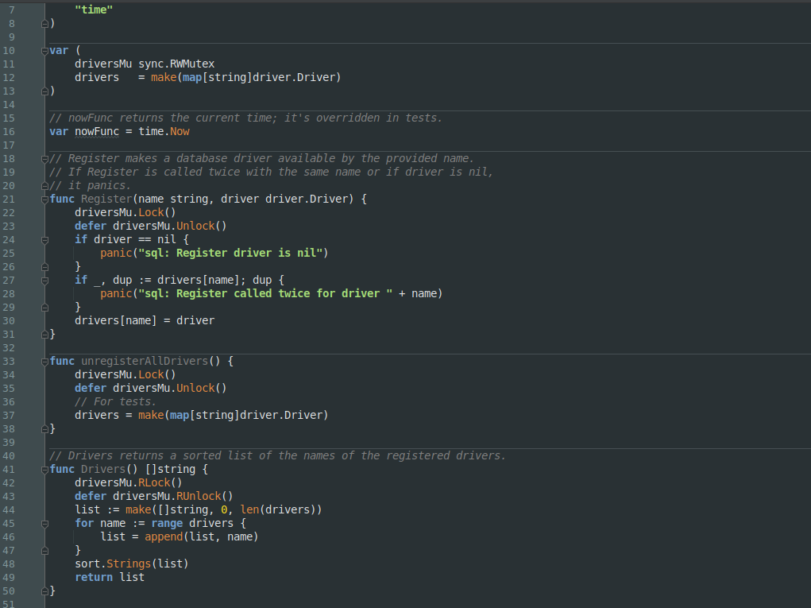
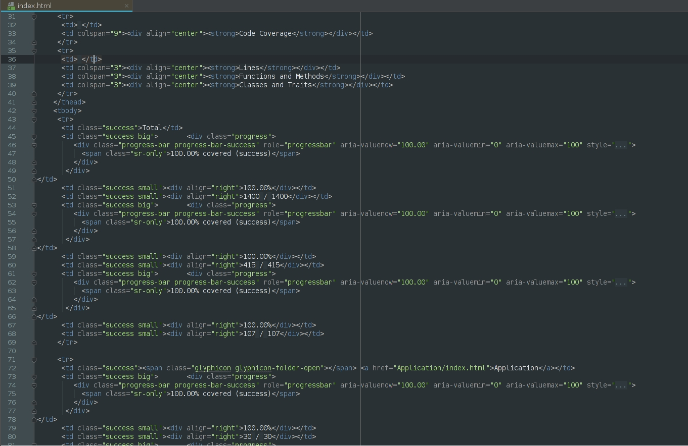
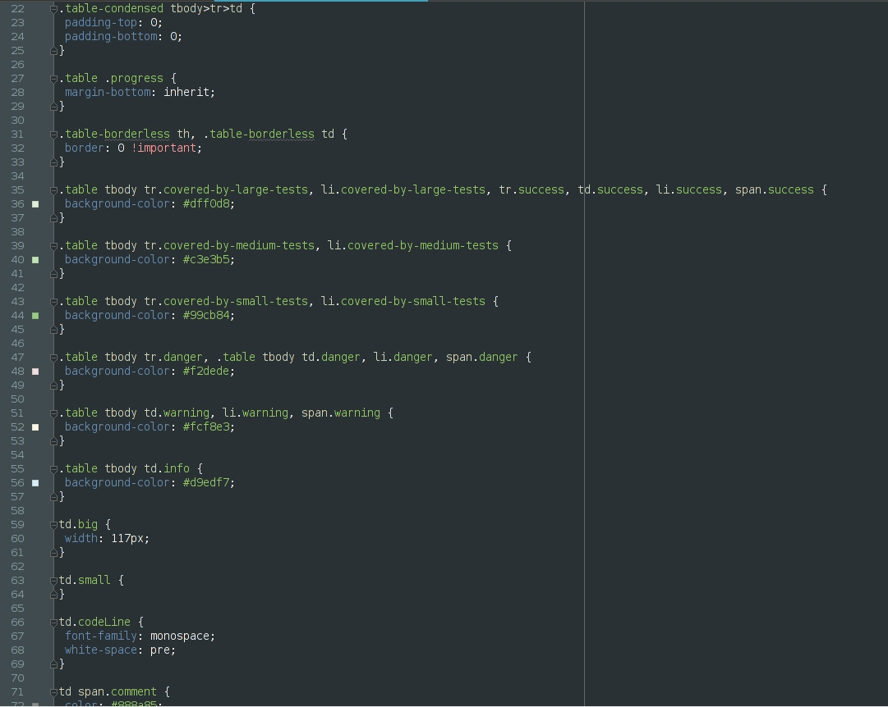
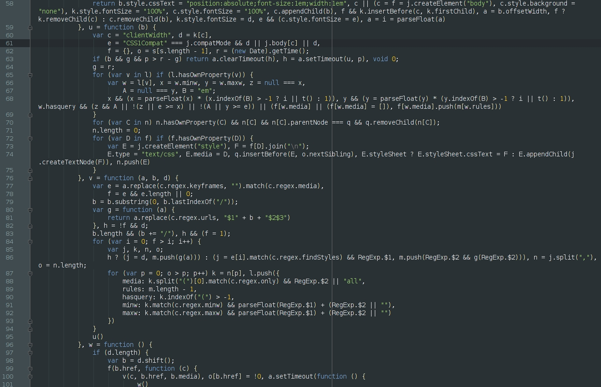
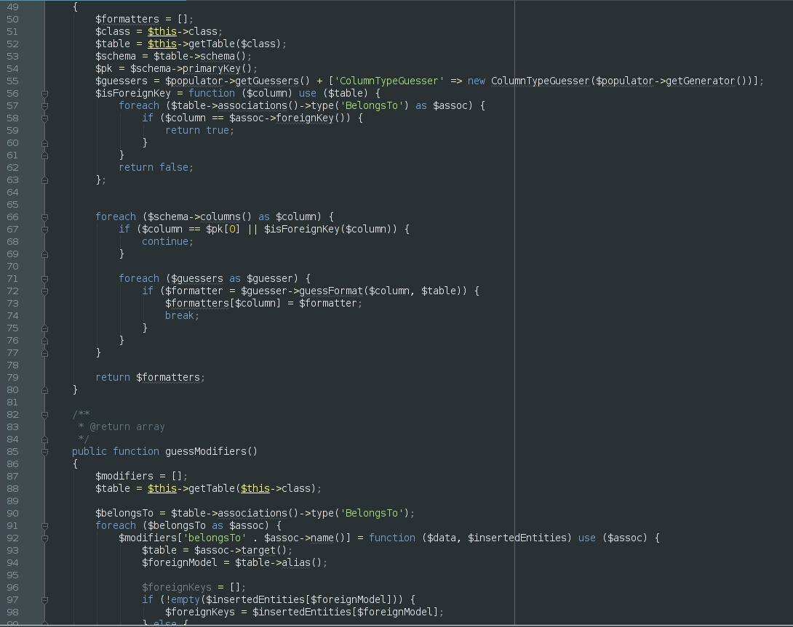
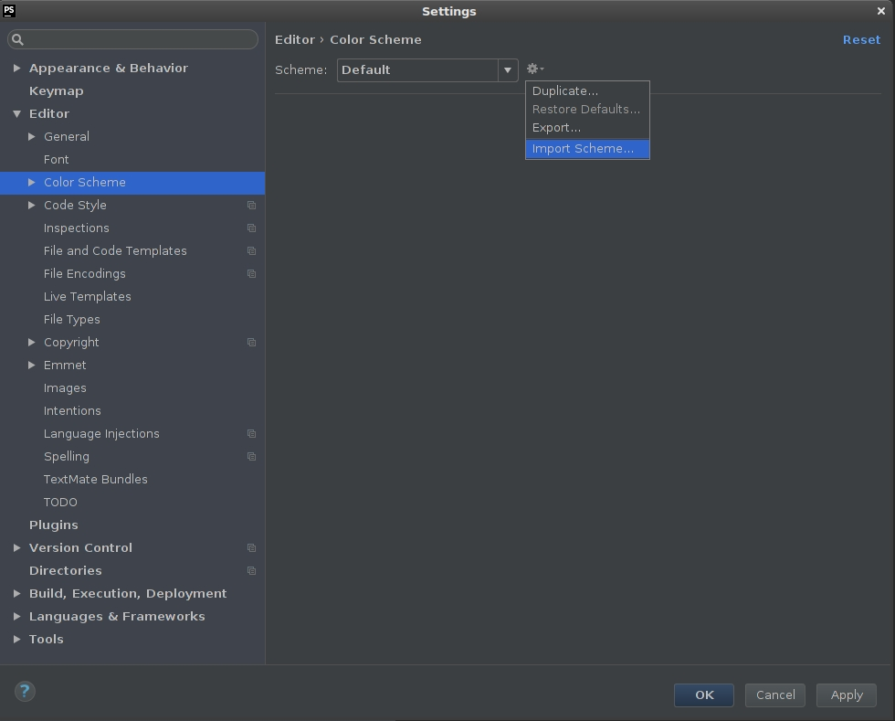

# Obsidian Dark

[![GitHub license][License img]][License src]

PhpStorm theme optimized for Dracula UI theme.

## Go

## HTML

## CSS

## JS

## PHP

# Installation
1. Download Obsidian-Dark.icls
2. Open Settings window (`Ctrl+Alt+S`)
3. Editor -> Color Scheme -> Import Scheme

  [License img]: https://img.shields.io/badge/license-MIT-brightgreen.svg
  [License src]: https://tldrlegal.com/license/mit-license
